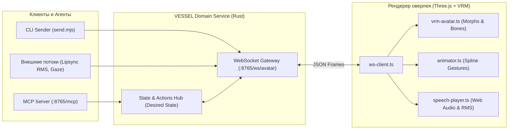

# VESSEL: Спецификация управления аватаром и WebSocket API

> **V.E.S.S.E.L.** — **V**irtual **E**ntity **S**urface for **S**ynthetic **E**xistence & **L**ife  
> Протокол обмена сообщениями в реальном времени между ядром рантайма и 3D WebGL оверлеем.

---

## 1. Архитектура взаимодействия

Управление 3D-аватаром в VESSEL осуществляется через локальный WebSocket-шлюз на порту `8765`:

* **URL WebSocket:** `ws://127.0.0.1:8765/ws/avatar`
* **Формат данных:** плоские JSON-объекты с обязательным полем `type`
* **Авторизация:** при установленной переменной `VESSEL_AUTH_TOKEN` заголовок `Authorization: Bearer <token>`
* **Защита Origin:** разрешены `localhost`, `127.0.0.1`, `tauri://*`, `null`, нативные клиенты без Origin



---

## 2. Роли и жизненный цикл подключения

### 2.1. Регистрация ролей
Клиенты регистрируют свою роль сразу после открытия сокета:

* **`renderer`** — окно оверлея, непосредственно выполняющее 3D-рендеринг, проигрывание звука и жестов.
* **`producer`** — внешний клиент (CLI, генератор аудио-потока, трекер взгляда).

```json
{
  "type": "register",
  "role": "renderer"
}
```

> **Маршрутизация:** Новые команды направляются последнему зарегистрированному renderer. Поколение соединения защищает его от снятия регистрации при отключении старого сокета.

### 2.2. Сигнал готовности (`ready`) и снимок состояния (`snapshot`)
После загрузки и парсинга VRM-модели рендерер отправляет сигнал готовности:
```json
{
  "type": "ready",
  "model": "my-avatar.vrm"
}
```
В ответ бэкенд немедленно высылает снимок текущего целевого состояния (`snapshot`), что гарантирует бесшовное восстановление мимики, позы и взгляда при реконнекте:
```json
{
  "type": "snapshot",
  "state": "idle",
  "expression": { "name": "happy", "intensity": 0.8 },
  "gaze": { "x": 0.0, "y": 0.1 },
  "framing": "bust"
}
```

### 2.3. Ответы producer

После регистрации producer получает `hello`: версию `v1`, возможности,
готовность renderer и снимок целевого состояния. Изменения state, expression
и framing подтверждаются сообщением `acknowledged`.

Жесты и речь получают `accepted` с `command_id` либо `rejected` с ошибкой.
Для речи renderer отправляет `playback_started` после фактического начала
воспроизведения; backend передаёт это событие producer. Итог приходит отдельным
`action_result`. При отключении текущего renderer ожидающие действия получают `failed`;
при отключении учитывается поколение соединения.

### 2.4. Heartbeat
Для контроля стабильности соединения стороны обмениваются текстовыми сообщениями:
* Клиент отправляет: `"ping"` или `{"type": "ping"}`
* Сервер отвечает: `"pong"` или `{"type": "pong"}`

---

## 3. Каналы управления аватаром

### 3.1. Состояние диалога (`state`)
Переключает фазу жизненного цикла агента, управляя паттернами дыхания, фокусом взгляда и позой покоя.
```json
{
  "type": "state",
  "state": "idle" | "listening" | "thinking" | "speaking"
}
```
* `"idle"` — покой, расслабленное покачивание бедер (hip sway), мягкое дыхание.
* `"listening"` — внимательное слушание, фиксация взгляда на пользователе.
* `"thinking"` — размышление, отведение взгляда вверх и в сторону.
* `"speaking"` — активная речь.

### 3.2. Мимика и эмоции (`expression`)
Управляет морфами лица (blendshapes) с заданной интенсивностью и плавным cross-fade переходом.
```json
{
  "type": "expression",
  "name": "neutral" | "happy" | "angry" | "sorrow" | "sad" | "surprised" | "relaxed",
  "intensity": 1.0
}
```
* `intensity`: от `0.0` до `1.0`.

### 3.3. Процедурные жесты (`gesture` и `stop_gesture`)
Запускает процедурные анимации на сплайнах Безье с корреляцией через `command_id`:
```json
{
  "type": "gesture",
  "command_id": "b3e04771-419b-4bf8-a461-12c8a2a893cb",
  "name": "nod" | "shake_head" | "tilt_head" | "wave" | "shrug"
}
```
* `"nod"` — кивок головой.
* `"shake_head"` — отрицательное покачивание головой.
* `"tilt_head"` — заинтересованный наклон головы.
* `"wave"` — взмах правой рукой с раскрытием пальцев (gesture flare).
* `"shrug"` — пожимание плечами с приподнятием ладоней.

Для отмены активного жеста отправляется:
```json
{
  "type": "stop_gesture",
  "command_id": "b3e04771-419b-4bf8-a461-12c8a2a893cb"
}
```

По окончании выполнения рендерер возвращает бэкенду статус:
```json
{
  "type": "action_result",
  "command_id": "b3e04771-419b-4bf8-a461-12c8a2a893cb",
  "action": "gesture",
  "status": "completed" | "cancelled" | "failed",
  "error": null
}
```

### 3.4. Направление взгляда (`gaze`)
Управляет вращением костей глаз и головы (`VRMLookAt`) с добавлением реалистичных микросаккад:
```json
{
  "type": "gaze",
  "x": 0.0,
  "y": 0.1
}
```
* `x`: от `-1.0` (влево) до `1.0` (вправо).
* `y`: от `-1.0` (вниз) до `1.0` (вверх).

### 3.5. Кадрирование камеры (`framing`)
Кинематографичная интерполяция позиции, точки фокуса и FOV камеры:
```json
{
  "type": "framing",
  "preset": "face" | "bust" | "half_body" | "full_body"
}
```
* `"face"` — крупный портретный план.
* `"bust"` — погрудный план по умолчанию.
* `"half_body"` — поясной план (демонстрация жестикуляции).
* `"full_body"` — ростовой общий план.

### 3.6. Воспроизведение речи (`speak` и `stop_speak`)
Запускает воспроизведение аудио через Web Audio API в окне оверлея с расчетом RMS громкости в реальном времени для процедурной артикуляции визем `aa`, `ih`, `ou`, `ee`, `oh`:
```json
{
  "type": "speak",
  "command_id": "a90df214-72de-42ef-a131-0cb1ff5fbc82",
  "audio_url": "http://127.0.0.1:8000/tts.wav",
  "audio_base64": "data:audio/wav;base64,...",
  "text": "Привет! Я твой компаньон.",
  "emotion": "happy"
}
```

Для остановки проигрывания:
```json
{
  "type": "stop_speak",
  "command_id": "a90df214-72de-42ef-a131-0cb1ff5fbc82"
}
```

По завершении проигрывания аудио рендерер возвращает:
```json
{
  "type": "action_result",
  "command_id": "a90df214-72de-42ef-a131-0cb1ff5fbc82",
  "action": "speak",
  "status": "completed" | "cancelled" | "failed",
  "error": null
}
```

### 3.7. Прямой поток липсинка (`lipsync`)
Для внешних TTS-пайплайнов, отдающих RMS амплитуду напрямую в миллисекундном стриме:
```json
{
  "type": "lipsync",
  "rms": 0.75,
  "viseme": "aa" | "ih" | "ou" | "ee" | "oh"
}
```
* Устаревшие пакеты (`> 150 ms`) автоматически отбрасываются для предотвращения рассинхронизации.

---

## 4. Консольная утилита для тестирования

Для быстрой отправки команд без участия агента используется утилита:
```powershell
# Примеры вызова из терминала
pnpm send gesture wave
pnpm send gesture nod
pnpm send emotion happy 1.0
pnpm send state thinking
pnpm send gaze 0.2 -0.1
pnpm send framing face
pnpm send '{"type": "gesture", "name": "shrug"}'
```
